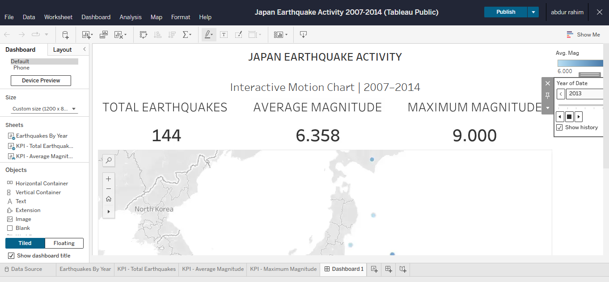
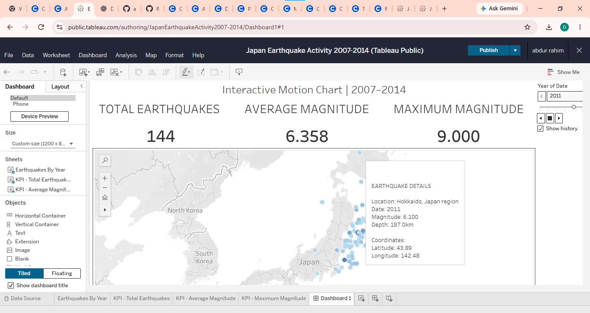

# Japan Earthquake Activity (2007–2014) | Tableau Dashboard

An interactive geographic data visualization project exploring earthquake activity around Japan between 2007 and 2014 using Tableau Public.

## Project Overview

This project was developed as an independent learning and portfolio project to practice Tableau visualization techniques, geographic mapping, time-based animation, and dashboard development.

The dashboard allows users to explore earthquake locations and observe changes in earthquake activity over time.

## Dashboard Preview

**Explore the interactive dashboard:** [View on Tableau Public](https://public.tableau.com/app/profile/abdur.rahim5381/viz/JapanEarthquakeActivity2007-2014/Dashboard1)

## Key Features

- Geographic visualization of earthquake locations around Japan.
- Interactive motion chart using Tableau Pages.
- Year-based animation covering 2007–2014.
- Magnitude-based color and size encoding.
- Interactive tooltips displaying earthquake details.
- KPI indicators for earthquake count and magnitude statistics.

## Tableau Visualizations

### 1. Geographic Earthquake Map

Displays the geographic distribution of earthquake events around Japan.

### 2. Interactive Earthquake Tooltip

Displays individual earthquake details, including location, date, magnitude, depth, latitude, and longitude.

## Key Metrics

The dashboard includes the following KPI indicators:

| Metric | Displayed Value |
|---|---:|
| Total Earthquakes | 144 |
| Average Magnitude | 6.358 |
| Maximum Magnitude | 9.000 |

*These values reflect the dashboard's displayed filter state.*

## Tools and Techniques

- Tableau Public
- Geographic Data Visualization
- Tableau Pages and Animation
- Calculated Fields and Aggregation
- KPI Development
- Dashboard Design and Data Storytelling

## Project Structure

- `Dashboard/` – Packaged Tableau workbook (.twbx)
- `Dataset/` – Original earthquake dataset and source information
- `Images/` – Dashboard and visualization screenshots

## Data Source and Attribution

The earthquake dataset was obtained through the learning materials provided in the **Tableau Business Intelligence Analyst Specialization on Coursera**.

The dataset was used for educational purposes and independent portfolio development.

[Coursera – Tableau Business Intelligence Analyst](https://www.coursera.org/specializations/tableau-business-intelligence-analyst)

Public redistribution of the dataset is subject to the original dataset's applicable permissions.

## Learning Outcomes

Through this project, I practiced:

- Building geographic visualizations using latitude and longitude.
- Creating time-based motion charts with Tableau Pages.
- Designing interactive tooltips.
- Developing KPI dashboards.
- Combining multiple visualizations into a single dashboard.

---

**Project Type:** Independent Learning & Portfolio Project  
**Visualization Tool:** Tableau Public
